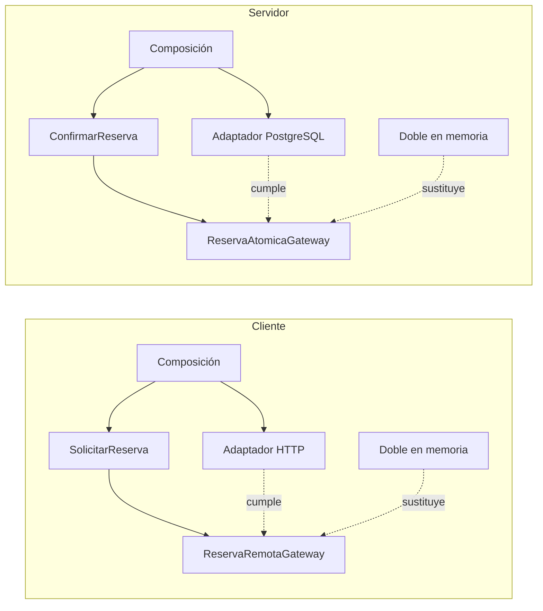

# EQ-08 — Mantenibilidad: reglas y adaptadores independientes

**26/11/2026, America/Lima.** Estado: **parcial en el escenario original completo;
acreditado en el núcleo de las funcionalidades construidas y en la sustitución
de adaptadores de reservas del cliente y servidor**.

No se implementaron mapas, imágenes ni funcionalidades. No se ejecutaron k6,
HTTP contra un backend, PostgreSQL, migraciones o GitHub Actions. No se inició
ningún servicio ni se modificaron los datos sintéticos existentes.

## 1. Escenario y criterios originales

Fuente: [escenario académico EQ-08](https://github.com/ErwinB23/barberia_app-arquitSoft-02-Erwin/blob/main/docs/01-analisis-de-sistema/08-escenarios-atributos-calidad.md),
contrastado con su copia local. [Transcripción íntegra del escenario original](criterio-original.md).
Su estado «Propuesto» pertenece al documento inicial; el resultado vigente es el
de este informe. El SHA-256 de la fuente está en [resultados.json](resultados.json).
Constitución 2.0.0, principios II/III: núcleo independiente, contratos propios y
composición por cada lado. No se editó ninguna definición ni umbral de cobertura.

| Condición original | Resultado y evidencia |
| --- | --- |
| Cero importaciones de presentación, infraestructura o SDK en dominio y aplicación | **Cumplida en lo construido:** 55 módulos de núcleo cliente y 33 servidor; 199 dependencias directas listadas, cero prohibidas. Los checkers verifican también dependencias transitivas, reexportaciones, tipos, ciclos y accesos globales prohibidos |
| Probar SolicitarReserva con un doble de ReservaRemotaGateway, sin HTTP ni Supabase | **Cumplida:** caso existente del cliente ejecutado con red bloqueada, 1 aprobado, cero intentos de conexión observados |
| Probar ConfirmarReserva con un doble de ReservaAtomicaGateway, sin PostgreSQL | **Cumplida:** caso existente del servidor ejecutado con red, lectura, escritura y entorno denegados; 1 aprobado |
| Sustituir un adaptador de mapas o imágenes y comprobar que no cambian sus reglas | **Pendiente:** módulos no completos. No se creó un adaptador ficticio ni se usa la prueba de reservas para dar esta condición por satisfecha |
| Pruebas y regresiones acordadas aprobadas, con informes separados | Evidencia completa de calidad del 25/11 reutilizada y ligada al núcleo actual, más las dos verificaciones puntuales de esta etapa. No se repitió la suite completa |

El entorno original se limita a funcionalidades construidas, pero su procedimiento
incluye expresamente mapas/imágenes. Por eso se distingue cumplimiento del núcleo
existente de cumplimiento integral del escenario, que permanece **parcial**.

## 2. Clean Architecture comprobada

| Lado | Módulos de archivo revisados | Núcleo dominio/aplicación | Aristas del grafo completo | Salida |
| --- | ---: | ---: | ---: | --- |
| Cliente | 298 | 55 | 975 | 0, aprobado |
| Servidor | 56 | 33 | 158 | 0, aprobado |

Son módulos de archivo, no 298 funcionalidades. Los checkers existentes resuelven
el grafo TypeScript real y fallan si hay imports no resueltos o archivos excluidos;
no se sustituyeron por búsquedas de cadenas. El listado adicional permite revisar
cada declaración de import/export, archivo destino, línea y tipo de dependencia:
[importaciones.csv](importaciones.csv) y [JSON con 88 archivos](importaciones.json).

Comandos nuevos, ambos sin red ni backend:

```powershell
node scripts/check-architecture.mjs
node scripts/check-server-architecture.mjs
```

Resultados separados: [cliente](architecture-client.log),
[servidor](architecture-server.log). Se conservan los checkers y sus reglas;
no se añadieron excepciones ni se debilitó ninguna dependencia permitida.

### Puertos, adaptadores e inversión de dependencias

| Responsabilidad | Cliente | Servidor |
| --- | --- | --- |
| Caso de uso real | `src/features/reservations/application/request-reservation.ts`: `createRequestReservation` devuelve `SolicitarReserva` | `supabase/functions/_shared/reservations/application/confirm-reservation.ts`: `createConfirmReservation` devuelve `ConfirmarReserva` |
| Puerto del núcleo | `application/reservation-remote-gateway.ts`: `ReservaRemotaGateway` | `application/reservation-atomic-gateway.ts`: `ReservaAtomicaGateway` |
| Adaptador productivo | `infrastructure/reservation-http-adapter.ts` | `infrastructure/postgres-reservation-adapter.ts` |
| Composición exterior | `src/composition/reservations-composition.ts`, inyecta gateway en la aplicación de reserva; esta crea SolicitarReserva | `_shared/reservations/composition.ts`, crea el adaptador y lo inyecta en ConfirmarReserva |
| Regla de dependencia | Aplicación conoce el contrato y dominio; el adaptador cumple el puerto | Aplicación conoce el contrato y dominio; el adaptador cumple el puerto |



Las flechas representan dependencias de composición/contrato, no un diagrama
de despliegue. Ambos casos reciben `Pick<Gateway, 'confirm'>`; no construyen
HTTP, SDK ni una conexión SQL. No exigen clases o herencia para cumplir el puerto.
La composición conoce la infraestructura; el núcleo no conoce la composición.

El cierre transitivo de cada caso consta solo de **cinco archivos internos**:
caso de uso, puerto, `domain/types.ts`, `domain/values.ts` y
`domain/reservation-input.ts`. No llega a infraestructura, presentación, Expo,
Supabase, Deno, Node o un driver de PostgreSQL. Los runtimes de las pruebas son
Node y Deno; eso no convierte al núcleo en dependiente de sus API.

## 3. Sustitución ejecutada sin servicios

### Cliente

Prueba existente: `tests/unit/reservations/confirmation.test.ts`, caso
`request use case forwards only validated values and preserves dependency error safety`.

Se sustituyó el puerto por objetos en memoria: uno devuelve un resultado conocido,
otro produce un conflicto del dominio y otro un error de dependencia. El caso
real valida la entrada, delega al contrato y conserva errores de negocio sin
exponer detalles internos. No se reemplazó el caso de uso por una simulación.

Se compiló solamente ese archivo y sus dependencias con TypeScript estricto, en
una carpeta única bajo `.artifacts/eq08/`. No se utilizaron JS compilados antiguos
ni se borró `.test-build`. El proceso Node bloqueó `fetch`, HTTP/HTTPS y conexiones
net/TLS; el registro de instrumentación confirmó **cero intentos de red**.
Resultado: **1 aprobado, 0 fallos, 0 omitidos** dentro de la selección.
[Compilación](client-compile.log), [prueba](client-substitution.log).

### Servidor

Prueba existente: `tests/server/reservations/confirmation.test.ts`, caso
`reservation application actor closed values and dependency failure are safe`.

El doble de `ReservaAtomicaGateway` comprueba el actor y la entrada recibidos,
devuelve un resultado en memoria y permite verificar los errores de identidad,
conflicto y dependencia. El caso ejecutado es el productivo `ConfirmarReserva`.
El módulo de pruebas también contiene casos de adaptadores, pero no se ejecutaron
esos otros cinco: la selección acotada evita repetir sus regresiones aprobadas.

```powershell
deno test --no-config --no-lock --no-npm --no-remote --no-prompt --deny-net --deny-read --deny-write --deny-env --filter="reservation application actor closed values and dependency failure are safe" tests/server/reservations/confirmation.test.ts
```

Resultado: **1 aprobado, 0 fallos, 5 casos fuera de la selección**.
[Reporte del servidor](server-substitution.log). No se pidió permiso de red o
acceso al entorno para que el caso aprobara. La carga estática de módulos por Deno
no requiere conceder al código permiso de lectura de archivos de aplicación.

El primer intento del verificador usó un filtro Deno con anclas sin delimitadores:
seleccionó cero casos y fue rechazado por la aserción del propio verificador.
Se corrigió exclusivamente el selector; no fue un fallo del producto ni se contó
esa ejecución vacía como prueba aprobada. El registro original permanece privado.

Estas pruebas acreditan sustitución e independencia de casos de uso, **no** RLS,
transacciones, atomicidad o funcionamiento real de PostgreSQL. Esas garantías
conservan sus evidencias de integración independientes; aquí no se repiten.

## 4. Regresión y cobertura reutilizadas

Fuente: [reproducibilidad desde checkout limpio, 25/11/2026](../004-reservas/reproducibilidad.json),
commit probado `9192d1a1e36937f6f4e835839a90b881dbebf332`; reportes de
[calidad](../004-reservas/calidad.md) y
[CI previamente aprobada](https://github.com/ErwinB23/barbexa/actions/runs/45696792837).

Se compararon inventario y blobs Git de **los 88 archivos actuales del núcleo**
con el commit probado: coinciden, normalizando exclusivamente CRLF a LF.
Las pruebas unitarias, de servidor, presentación y arquitectura, y los checkers
también carecen de cambios frente a ese commit. La comparación no afirma que
todo el árbol de trabajo esté limpio: existen cambios previos de documentación
y del harness de laboratorio, que se conservaron.

| Alcance histórico | Líneas | Funciones | Ramas | Archivos ejecutables |
| --- | --- | --- | --- | ---: |
| Dominio/aplicación cliente | 3.808/3.808 = 100 % | 447/447 = 100 % | 1.725/1.852 = 93,1425 % | 45 |
| Dominio/aplicación servidor | 1.640/1.640 = 100 % | 99/99 = 100 % | 1.007/1.007 = 100 % | 29 |

Los contratos exclusivamente de tipos no producen código ejecutable: por eso
la cobertura usa 45/29 archivos y la arquitectura revisa 55/33. La cobertura
reutilizada no mide UI, infraestructura ni todas las ramas posibles del negocio.
No se recalculó un porcentaje parcial con los dos casos para reemplazarla.

Regresiones históricas aprobadas: 493 de núcleo/integración y 652 de presentación/
integración (se solapan, **no sumar**); 38 pruebas del checker cliente, 45 del
servidor, 18 de entorno y 96 Deno; cero fallos u omitidas en esas ejecuciones.
Los dos casos actuales son evidencia adicional puntual, no una nueva ejecución
completa de esa batería. No se ejecutaron `npm run check`, cobertura, instalación
de dependencias ni exportación Web de nuevo.

## 5. Reproducción y archivos entregados

Desde la raíz, un comando prepara su propia compilación única y reproduce
únicamente las comprobaciones de este informe:

```powershell
node docs/evaluacion/evidencias/eq08/verificar-eq08.mjs
```

Requiere Node, Deno, Git y el TypeScript ya instalado del proyecto. El comando
no instala dependencias, no inicia backend ni lee archivos de credenciales.
Descarga de módulos remotos/npm deshabilitada en Deno. Solo se elimina
`SSLKEYLOGFILE` del entorno del subproceso Deno para no heredar un destino local
de diagnóstico TLS; no se modifica la variable del usuario ni del producto.

El comando genera carpetas privadas únicas y no elimina resultados anteriores.
Los comandos exactos de compilación/pruebas están en `resultados.json`, con
`<repo>` y `<run>` para evitar publicar rutas personales. Registros completos
e instrumentación permanecen en el directorio privado indicado allí.

Entregables: este informe; `criterio-original.md`; `resultados.json`;
`importaciones.csv`/`.json`; logs separados de checkers, compilación y pruebas;
[trazabilidad de ambos casos](trazabilidad.json); comparación de fuentes de
regresión; `preservacion-sha256.json`; y `verificar-eq08.mjs`.
[Verificación documental y de preservación](verificacion-entrega.json).
Para comprobar esos archivos sin volver a ejecutar pruebas:
`node docs/evaluacion/evidencias/eq08/verificar-entrega.mjs`.
**814 archivos de producto, pruebas, scripts, configuraciones, migraciones,
SDD y Constitución preservados por SHA-256.** No se modificó código funcional,
interfaces, Cloud, migraciones o Actions. Sin staging, commits o push.

## 6. Siguiente trabajo mínimo para EQ-09 con Playwright

No ejecutado en esta etapa. El siguiente paquete debe limitarse al recorrido
**Web de horario ocupado**, reutilizando las evidencias del resto del proyecto:

1. Preparar la Web apuntando exclusivamente al backend local de pruebas y cuentas
   sintéticas. Comprobar las herramientas Playwright ya disponibles; no iniciar
   sesiones reales de Cloud ni instalar paquetes por invocación automática.
2. En un viewport móvil pequeño, elegir servicio y turno, provocar un conflicto
   controlado y comprobar el mensaje textual, la conservación de servicios y una
   acción accesible para consultar/elegir otro horario. Un 409 simulado por routing
   solo acreditaría presentación; para afirmar E2E integrado debe producirlo el
   backend local con un turno ocupado por otra sesión sintética.
3. Capturar solicitudes y comprobar ausencia de reenvío automático o duplicados;
   continuar una vez con otro horario. Guardar reporte, captura/trace sanitizados
   y comprobación de las reservas creadas. No hace falta una nueva campaña k6.
4. Revisar foco/teclado, etiquetas accesibles y mensaje comprensible sin depender
   del color. Este recorrido automático no reemplaza observación con usuarios.

El escenario original EQ-09 también exige ubicación denegada con alternativa
textual/mapa, Android real (Maestro), accesibilidad y participantes con muestra y
umbral definidos antes de evaluar. Mapas no completos siguen pendientes;
Playwright con viewport móvil **no acredita Android nativo**. No desarrollar esos
módulos ni declarar EQ-09 integral con un único recorrido Web.

**Estado final EQ-08:** evidencia consolidada y aprobada para el núcleo construido;
**parcial integralmente** por la sustitución de proveedor de mapas/imágenes pendiente.
